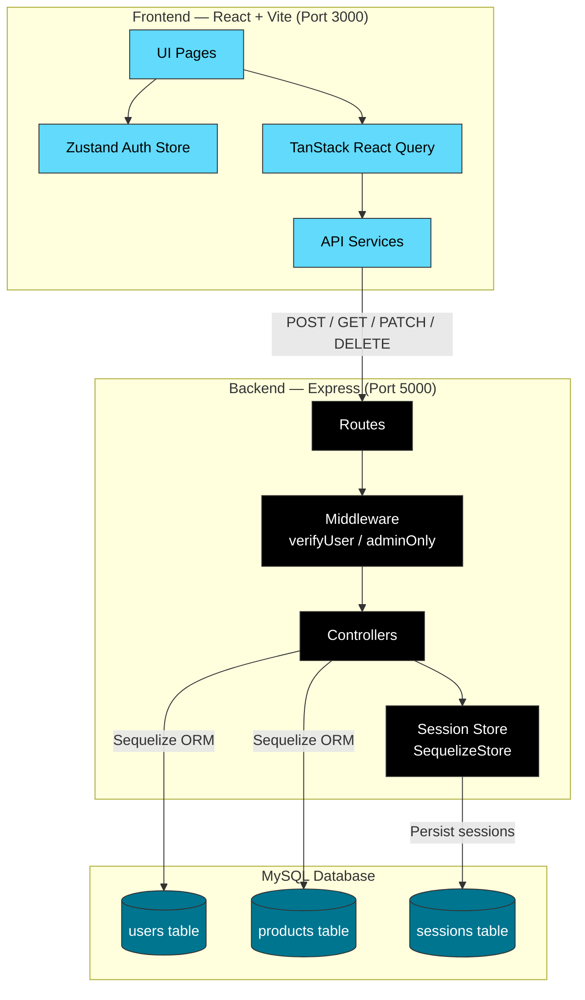
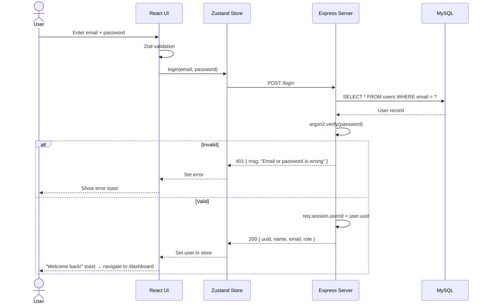
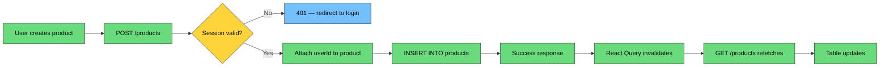
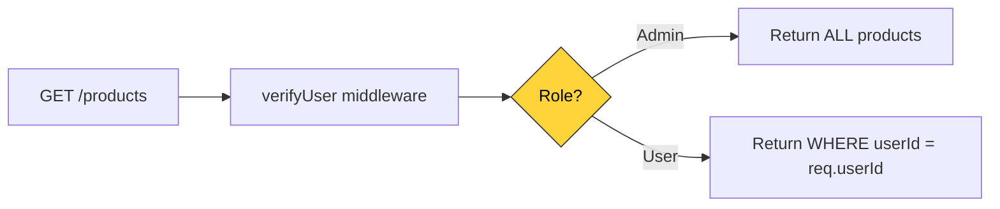
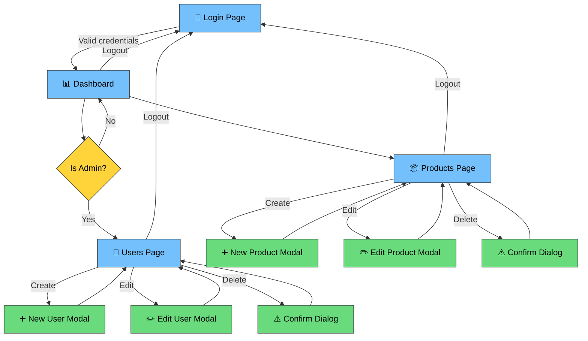

# Login — Multi-Role Backend & Frontend

[](https://react.dev/)
[](https://vitejs.dev/)
[](https://expressjs.com/)
[](https://sequelize.org/)
[](https://www.mysql.com/)
[](https://tailwindcss.com/)
[](#-license)

A full-stack **role-based access control (RBAC)** application with a React + Vite frontend and an Express + Sequelize + MySQL backend. Features session-based authentication, admin/user role separation, and full CRUD operations for users and products — built with modern best practices and a clean, responsive UI.

---

## 📌 Table of Contents

1. [Project Overview](#-project-overview)
2. [What's New](#-whats-new)
3. [Project Architecture](#️-project-architecture)
4. [Folder Structure](#-folder-structure)
5. [Application Flow](#-application-flow)
6. [Data Flow & Process Visualization](#-data-flow--process-visualization)
7. [UI/UX Flow](#️-uiux-flow)
8. [Installation & Setup](#️-installation--setup)
9. [Usage](#-usage)
10. [Future Improvements](#-future-improvements)
11. [Contribution Guide](#-contribution-guide)
12. [License](#-license)

---

## 📌 Project Overview

This application provides a complete authentication and resource management system with **two distinct roles**: **Admin** and **User**.

| Role | Capabilities |
|------|-------------|
| **Admin** | Full CRUD over all users and all products; views global statistics |
| **User** | CRUD over own products only; views personal dashboard and account info |

### Key Goals
- **Secure session-based authentication** — server-side sessions stored in MySQL via Sequelize Store
- **Role-based access control** — middleware and controller-level enforcement
- **Type-safe forms** — Zod schema validation with React Hook Form
- **Optimistic data fetching** — TanStack React Query for server state management
- **Responsive, accessible UI** — Tailwind CSS + Radix UI primitives + Lucide icons

---

## 🚀 What's New

### Features
- ✅ **Role-aware navigation** — sidebar dynamically shows/hides admin-only links
- ✅ **Session restoration** — automatic `/me` check on app mount for persistent sessions
- ✅ **Admin user management** — create, edit, delete users with role assignment
- ✅ **Product ownership tracking** — every product is linked to its creator
- ✅ **Inline RBAC on products** — admins manage all products; users manage only their own
- ✅ **Responsive layout** — desktop sidebar + mobile hamburger menu with drawer
- ✅ **Loading skeletons** — table and card skeletons for smooth perceived performance
- ✅ **Form validation** — Zod schemas for login, user CRUD, and product CRUD
- ✅ **Delete confirmations** — Radix AlertDialog for destructive actions
- ✅ **Toast notifications** — success/error feedback via react-hot-toast

### Architecture
- 🏗️ Sequelize migrations & seeders for reproducible database setup
- 🏗️ Centralized Axios instance with `withCredentials: true`
- 🏗️ Zustand store for auth state + React Query for all server data
- 🏗️ Vite proxy configuration for seamless dev API forwarding

---

## 🏗️ Project Architecture

The system follows a **client-server architecture** with clear separation of concerns:



### Tech Stack Summary

| Layer | Technology |
|-------|-----------|
| **Frontend Framework** | React 19 |
| **Build Tool** | Vite 8 |
| **Styling** | Tailwind CSS 4 |
| **Routing** | React Router DOM 6 |
| **Auth State** | Zustand 5 |
| **Server State** | TanStack React Query 5 |
| **HTTP Client** | Axios |
| **Form Validation** | React Hook Form + Zod |
| **UI Components** | Radix UI (Dialog, AlertDialog) |
| **Backend Framework** | Express.js 4 |
| **ORM** | Sequelize 6 |
| **Database** | MySQL (mysql2) |
| **Session Storage** | connect-session-sequelize |
| **Password Hashing** | argon2 |

---

## 📂 Folder Structure

```
Login-Multi-Role-Backend/
├── client/                          # Frontend — React + Vite
│   ├── public/                      # Static assets
│   ├── src/
│   │   ├── assets/                  # Images, icons, etc.
│   │   ├── components/              # Reusable UI components
│   │   │   ├── ConfirmDialog.jsx    # Delete confirmation (Radix AlertDialog)
│   │   │   ├── FormField.jsx        # Form field wrapper + Input/Select
│   │   │   ├── Layout.jsx           # App shell (sidebar + mobile header)
│   │   │   ├── Modal.jsx            # Create/Edit dialog (Radix Dialog)
│   │   │   ├── RouteGuard.jsx       # PrivateRoute & AdminRoute guards
│   │   │   └── Skeleton.jsx         # Loading placeholders
│   │   ├── hooks/                   # Custom hooks (reserved)
│   │   ├── lib/
│   │   │   └── api.js               # Axios instance (baseURL: /api)
│   │   ├── pages/
│   │   │   ├── DashboardPage.jsx    # Stats + account info
│   │   │   ├── LoginPage.jsx        # Email/password authentication
│   │   │   ├── ProductsPage.jsx     # Product CRUD table
│   │   │   └── UsersPage.jsx        # User CRUD table (admin only)
│   │   ├── services/
│   │   │   ├── productService.js    # Product API wrappers
│   │   │   └── userService.js       # User API wrappers
│   │   ├── store/
│   │   │   └── authStore.js         # Zustand auth state (user, login, logout)
│   │   ├── App.jsx                  # Route definitions + QueryClient
│   │   ├── main.jsx                 # React entry point
│   │   └── index.css                # Tailwind + custom theme
│   ├── vite.config.js               # Dev server (port 3000, API proxy)
│   └── package.json
│
├── server/                          # Backend — Express + Sequelize
│   ├── config/
│   │   └── Database.js              # Sequelize connection config
│   ├── controllers/
│   │   ├── Auth.js                  # Login / Me / Logout
│   │   ├── Products.js              # Product CRUD with RBAC
│   │   └── Users.js                 # User CRUD (admin only)
│   ├── middleware/
│   │   └── AuthUser.js              # verifyUser + adminOnly middleware
│   ├── migrations/                  # Sequelize DB migrations
│   ├── models/
│   │   ├── ProductModel.js          # Product schema (uuid, name, price, userId)
│   │   └── UserModel.js             # User schema (uuid, name, email, password, role)
│   ├── routes/
│   │   ├── AuthRoute.js             # Auth endpoints
│   │   ├── ProductRoute.js          # Product endpoints
│   │   └── UserRoute.js             # User endpoints
│   ├── scripts/
│   │   ├── create-database.js       # DB creation helper
│   │   └── setup-database.js        # Migrate + seed combined
│   ├── seeders/
│   │   ├── *-demo-users.cjs         # Default admin + user accounts
│   │   └── *-demo-products.cjs      # Sample product data
│   ├── index.js                     # Express app entry point
│   └── package.json
│
└── README.md                        # You are here
```

### Key Files at a Glance

| File | Purpose |
|------|---------|
| `server/index.js` | Express app setup — middleware, routes, session config |
| `server/middleware/AuthUser.js` | `verifyUser` and `adminOnly` — RBAC gatekeepers |
| `server/controllers/Products.js` | Inline role checks for product ownership |
| `client/src/store/authStore.js` | Single source of truth for auth state |
| `client/src/components/RouteGuard.jsx` | Route-level protection with loading states |
| `client/src/components/Layout.jsx` | Role-aware responsive shell |

---

## 🔄 Application Flow

```mermaid
flowchart TD
    A[User visits app] --> B{Has session?}
    B -->|No| C[Redirect to /login]
    B -->|Yes| D[fetchMe on mount]

    C --> E[Enter email + password]
    E --> F{Valid credentials?}
    F -->|No| G[Show error toast]
    G --> E
    F -->|Yes| H[Set session.userId]
    H --> D

    D --> I{User found?}
    I -->|No| C
    I -->|Yes| J[Store user in Zustand]

    J --> K[Render /dashboard]
    K --> L{Navigate to?}

    L -->|Products| M[/products — CRUD]
    L -->|Users| N{Is admin?}
    L -->|Logout| O[Destroy session]

    N -->|Yes| P[/users — Admin CRUD]
    N -->|No| Q[Redirect to /dashboard]

    O --> C

    classDef decision fill:#ffd43b,stroke:#333,color:#000
    classDef action fill:#69db7c,stroke:#333,color:#000
    classDef page fill:#74c0fc,stroke:#333,color:#000
    class B,F,I,N decision
    class A,C,E,G,H,J,K,L,M,O,P,Q action
    class D page
```

### Step-by-Step Breakdown

1. **App Mount** — `App.jsx` triggers `fetchMe()` via `useAuthStore`
2. **Session Check** — `GET /me` hits the server; Express checks `req.session.userId`
3. **Route Guard** — `PrivateRoute` blocks `/dashboard` and `/products` until `user` is set
4. **Dashboard Load** — Stats cards query products/users via React Query
5. **Navigation** — Sidebar links respect role; `/users` is admin-only
6. **Logout** — `DELETE /logout` destroys the session; redirect to `/login`

---

## 📊 Data Flow / Process Visualization

### Login Flow (Sequence Diagram)



### Product CRUD Flow



### Role-Based Data Access



---

## 🖥️ UI/UX Flow

### User Journey



### UX Best Practices Applied

| Practice | Implementation |
|----------|---------------|
| **Optimistic loading** | Skeleton placeholders during data fetches |
| **Error feedback** | Toast notifications for all async operations |
| **Destructive action safety** | Confirmation dialog before deletes |
| **Role-aware UI** | Admin-only links hidden from regular users |
| **Responsive design** | Mobile drawer + desktop sidebar layout |
| **Active state indication** | Current route highlighted in navigation |
| **Form validation** | Real-time Zod validation with inline errors |
| **Session persistence** | Auto-restore session on page reload |

### Responsive Breakpoints

| Viewport | Layout |
|----------|--------|
| **Desktop (≥768px)** | Fixed 260px sidebar with navigation |
| **Mobile (<768px)** | Top bar + hamburger menu → slide-in drawer |

---

## ⚙️ Installation & Setup

### Prerequisites

| Requirement | Version |
|-------------|---------|
| [Node.js](https://nodejs.org/) | ≥ 18.x |
| [MySQL](https://www.mysql.com/) | ≥ 5.7 / 8.0 |
| npm or yarn | Latest |

### 1. Clone the Repository

```bash
git clone https://github.com/your-username/Login-Multi-Role-Backend.git
cd Login-Multi-Role-Backend
```

### 2. Backend Setup

```bash
# Navigate to server directory
cd server

# Install dependencies
npm install

# Create .env file (copy from example or create new)
# Required variables:
#   APP_PORT=5000
#   DB_HOST=localhost
#   DB_USER=root
#   DB_PASS=your_mysql_password
#   SESS_SECRET=your_secret_string
```

```bash
# Create the database (automated)
npm run db:create

# Run migrations to create tables
npm run db:migrate

# Seed demo data (creates default admin + user accounts)
npm run db:seed

# — OR do it all in one command —
npm run db:setup
```

### 3. Frontend Setup

```bash
# Navigate to client directory
cd ../client

# Install dependencies
npm install
```

### 4. Start Both Servers

> **Terminal 1 — Backend**
> ```bash
> cd server
> npm run dev
> ```
> Server starts on `http://localhost:5000`

> **Terminal 2 — Frontend**
> ```bash
> cd client
> npm run dev
> ```
> App starts on `http://localhost:3000` with API proxy to backend

---

## 🧪 Usage

### Default Demo Credentials

After running the seeders, use these accounts to log in:

| Email | Password | Role |
|-------|----------|------|
| `admin@example.com` | `admin123` | Admin |
| `user@example.com` | `user123` | User |

### API Endpoints

All endpoints require `credentials: true` (cookie-based sessions).

#### Authentication

| Method | Endpoint | Access | Body |
|--------|----------|--------|------|
| `POST` | `/login` | Public | `{ email, password }` |
| `GET` | `/me` | Session | — |
| `DELETE` | `/logout` | Session | — |

#### Users (Admin Only)

| Method | Endpoint | Access | Body |
|--------|----------|--------|------|
| `GET` | `/users` | Admin | — |
| `GET` | `/users/:id` | Admin | — |
| `POST` | `/users` | Admin | `{ name, email, password, confPassword, role }` |
| `PATCH` | `/users/:id` | Admin | `{ name, email, password?, confPassword?, role }` |
| `DELETE` | `/users/:id` | Admin | — |

#### Products (Authenticated Users)

| Method | Endpoint | Access | Body |
|--------|----------|--------|------|
| `GET` | `/products` | Auth | — |
| `GET` | `/products/:id` | Auth | — |
| `POST` | `/products` | Auth | `{ name, price }` |
| `PATCH` | `/products/:id` | Auth | `{ name, price }` |
| `DELETE` | `/products/:id` | Auth | — |

### Database Management Commands

```bash
# Create database
npm run db:create

# Run migrations
npm run db:migrate

# Undo all migrations
npm run db:migrate:undo

# Seed demo data
npm run db:seed

# Undo all seeds
npm run db:seed:undo
```

---

## 📈 Future Improvements

| Area | Planned Enhancement |
|------|-------------------|
| **Security** | Rate limiting on login endpoint (brute-force protection) |
| **Security** | CSRF token support for session-based auth |
| **Auth** | Public self-registration endpoint (`POST /register`) |
| **Auth** | Password reset via email link |
| **Auth** | Refresh token / session expiry management |
| **Middleware** | Optimize `adminOnly` to reuse user data from `verifyUser` |
| **API** | Pagination, filtering, and sorting for list endpoints |
| **API** | Input sanitization and request validation middleware |
| **Frontend** | Dark mode toggle |
| **Frontend** | Unit & integration tests (Vitest / React Testing Library) |
| **DevOps** | Docker Compose for one-command local environment |
| **DevOps** | CI/CD pipeline (lint, test, build) |
| **Scalability** | Environment-based CORS origin configuration |
| **Scalability** | Redis session store for production deployments |

---

## 🤝 Contribution Guide

Contributions are welcome! Here's how to get started:

1. **Fork the repository**
2. **Create a feature branch**
   ```bash
   git checkout -b feature/your-feature-name
   ```
3. **Make your changes** — follow the existing code style
4. **Commit with a clear message**
   ```bash
   git commit -m "feat: add rate limiting to login endpoint"
   ```
5. **Push to your branch**
   ```bash
   git push origin feature/your-feature-name
   ```
6. **Open a Pull Request** — describe what you changed and why

### Code Style Guidelines
- Use ES module syntax (`import`/`export`)
- Follow existing naming conventions
- Add comments only for non-obvious logic
- Test your changes manually before submitting

---

## 📄 License

Copyright © 2026 **Mohammad Muzzamil** — All rights reserved.

This project is licensed under the **ISC License**. See the [LICENSE](LICENSE) file for details.

---

## 🙌 Credit

Designed, developed, and maintained by **Mohammad Muzzamil**.

| Platform | Link |
|----------|------|
| 🌐 **Portfolio** | [muzzamilportfolio-v2.netlify.app](https://muzzamilportfolio-v2.netlify.app/) |
| 🐙 **GitHub** | [github.com/muzzamil7770](https://github.com/muzzamil7770) |
| 💼 **LinkedIn** | [linkedin.com/in/mohammadmuzzamil7770](https://www.linkedin.com/in/mohammadmuzzamil7770/) |

---

<p align="center">Built with ❤️ by <a href="https://github.com/muzzamil7770">Mohammad Muzzamil</a></p>
